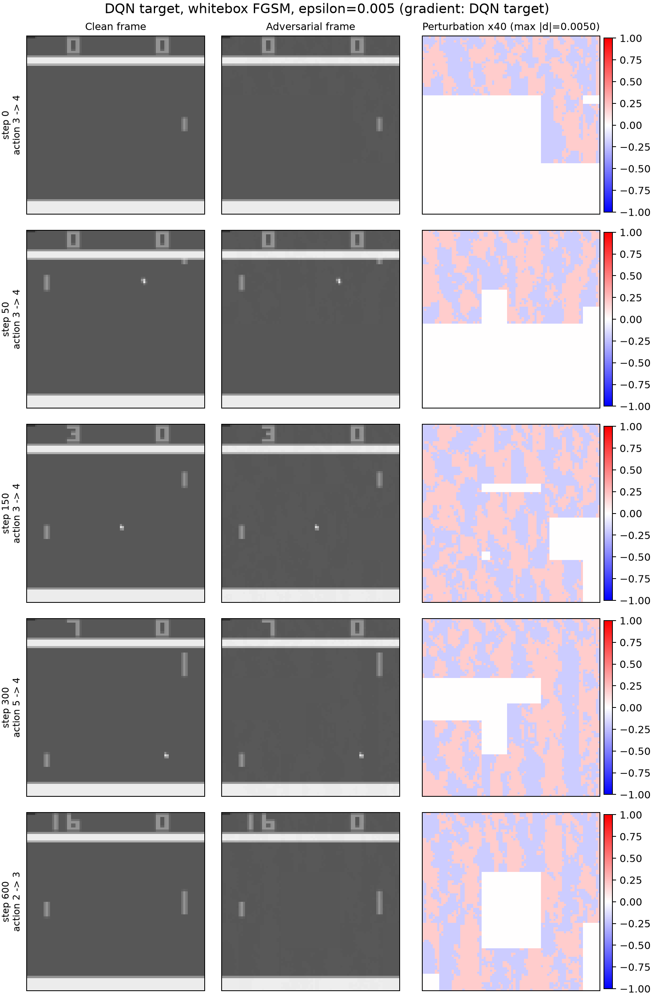

# L∞ FGSM attacks on Atari Pong policies

[](https://github.com/Paul4805/pong-fgsm-adversarial-rl/actions/workflows/tests.yml)
[](https://www.python.org/)
[](https://pytorch.org/)
[](https://stable-baselines3.readthedocs.io/)
[](LICENSE)

A reproducible implementation of **untargeted Fast Gradient Sign Method
(FGSM)** attacks against a neural-network policy in Atari Pong. The project
includes a white-box DQN attack and a black-box transfer attack using a
separately trained A2C surrogate.



*Clean, adversarial, and amplified-perturbation frames at selected timesteps.
The perturbation is constrained to `||δ||∞ ≤ 0.005`.*

## Highlights

- Standard Pong preprocessing: frame skip 4, grayscale, 84×84, 4-frame stack.
- Networks consume normalized `[0, 1]` observations directly.
- DQN target policy and A2C surrogate trained with different algorithms.
- White-box and black-box FGSM with `ε = 0.005` and `ε = 0.001`.
- Paired 10-episode clean/adversarial evaluation with reward drop and
  action-change rate.
- Reproducible metric files and side-by-side frame visualizations committed to
  the repository.
- Optional from-scratch DQN/A2C training script.

## Results

Clean DQN mean return over 10 episodes: **20.70 ± 0.46**.

| Attack | ε | Clean return | Adversarial return | Mean reward drop | Action-change rate |
|---|---:|---:|---:|---:|---:|
| White-box DQN | 0.005 | 20.70 | −19.80 | **+40.50** | **89.10%** |
| White-box DQN | 0.001 | 20.70 | −13.80 | **+34.50** | **81.88%** |
| Black-box A2C → DQN | 0.005 | 20.70 | −4.70 | **+25.40** | **58.89%** |
| Black-box A2C → DQN | 0.001 | 20.70 | 21.00 | −0.30 | 18.13% |

The negative drop at the smaller black-box budget is reported as observed:
many individual actions change, but the transferred perturbation was not strong
enough to reduce the episode return in this sample.

Full output:

- [`results/summary.json`](results/summary.json) — aggregate and per-episode data
- [`results/summary.csv`](results/summary.csv) — aggregate table
- [`results/episodes.csv`](results/episodes.csv) — every episode
- [`results/report.md`](results/report.md) — generated Markdown report
- [`visualizations/summary.png`](visualizations/summary.png) — return/action-change plot

Frame grids show the first evaluation episode; metrics cover all 10 episodes.

## Quick start

```bash
git clone https://github.com/Paul4805/pong-fgsm-adversarial-rl.git
cd pong-fgsm-adversarial-rl

python -m venv .venv
# Windows: .venv\Scripts\activate
# Unix:    source .venv/bin/activate

pip install -r requirements.txt
pip install -e .
python -m rai.download_models
```

Run the full evaluation:

```bash
python -m rai.evaluate --target dqn --surrogate a2c --modes whitebox blackbox --epsilons 0.005 0.001 --episodes 10 --max-steps 10000
```

On a machine without a GPU, add `--device cpu`. Evaluation is deterministic for
a fixed seed but can be slow because the attack computes an input gradient at
every step.

### Useful options

```bash
# Only the white-box attack
python -m rai.evaluate --modes whitebox --epsilons 0.005

# Attack a random 25% of steps
python -m rai.evaluate --attack-fraction 0.25

# Use the target action as the black-box FGSM label
python -m rai.evaluate --label-source target

# Skip visualization generation
python -m rai.evaluate --no-visualize
```

## Repository layout

```
src/rai/
├── envs.py             # PongNoFrameskip-v4 registration + preprocessing
├── models.py           # checkpoint download/load, compatibility, [0,1] adapter
├── attack.py           # L∞ FGSM implementation
├── evaluate.py         # paired 10-episode evaluation and result export
├── train.py            # optional DQN/A2C from-scratch training
├── visualize.py        # frame grids and summary plots
└── download_models.py

tests/                  # dependency-light FGSM unit tests
results/                # committed evaluation outputs
visualizations/         # committed frame grids and summary plot
models/                 # checkpoints are downloaded, not committed
.github/workflows/      # CI
```

## Environment and preprocessing

Modern Gymnasium no longer ships a preprocessed `PongNoFrameskip-v4` by
default. This project registers that exact ID as an equivalent of:

1. `ALE/Pong-v5` with `frameskip=1` and `repeat_action_probability=0.0`
2. `AtariPreprocessing(frame_skip=4, screen_size=84, grayscale=True,
   noop_max=30, terminal_on_life_loss=False, scale_obs=True)`
3. `FrameStackObservation(stack_size=4)`

The resulting observation is `float32`, shape `(4, 84, 84)`, range `[0, 1]`.
`ale-py` installs its own legacy `PongNoFrameskip-v4` that returns raw
`210×160×3` RGB frames; `rai.envs.register_pong_envs` replaces that registry
entry so the ID has the required preprocessing.

The RL Zoo checkpoints were trained on pixels in `[0, 255]`.
`rai.models.rescale_model_to_unit_interval` multiplies the first convolution's
weights by 255, which is mathematically equivalent to feeding `x / 255` into the
original network. The attack code therefore receives normalized `[0, 1]`
observations directly, with no hidden normalization step.

## Attack definition

For an observation `s ∈ [0, 1]` and the clean policy action:

```
L(s) = CrossEntropy(policy_logits(s), a_clean)
```

- For DQN, `policy_logits(s)` are the six Q-values.
- For A2C, `policy_logits(s)` are the categorical action logits.

FGSM performs one gradient-ascent step:

```
s_adv = clip(s + ε · sign(∇_s L(s)), 0, 1)
```

The **white-box** attack differentiates the DQN target. The **black-box**
attack differentiates the A2C surrogate and transfers `s_adv` to the DQN target.
The environment itself is never modified; only the observation used for action
selection is perturbed.

## Evaluation protocol

- Paired seeds `seed, seed+1, ...` are used for clean and adversarial episodes.
- The clean mean return is recorded first.
- FGSM is applied at every step by default (`--attack-fraction 1.0`).
- `action_change_rate` is the fraction of attacked steps where
  `argmax target(s_adv) != argmax target(s)`.
- Reward drop is `mean(clean return) - mean(adversarial return)`, with the
  per-episode paired drop also stored in `summary.json`.
- Deterministic actions use the greedy `argmax` of Q-values/logits.

## Pretrained checkpoints

The reported experiments use the Stable-Baselines3 RL Zoo checkpoints:

| Role | Repository | Algorithm |
|---|---|---|
| Target | `sb3/dqn-PongNoFrameskip-v4` | DQN |
| Black-box surrogate | `sb3/a2c-PongNoFrameskip-v4` | A2C |

Both were trained for 10M environment steps. A2C is a different algorithm from
DQN, making the transfer setting a genuine black-box surrogate setup.

Checkpoints are deliberately excluded from Git. Download them with:

```bash
python -m rai.download_models
```

Expected paths are documented in [`models/README.md`](models/README.md).

## Optional from-scratch training

```bash
# DQN target
python -m rai.train --algo dqn --timesteps 10000000 --output models/dqn/trained.zip

# A2C surrogate
python -m rai.train --algo a2c --timesteps 10000000 --n-envs 8 --output models/a2c/trained.zip
```

Then pass `--target-checkpoint` / `--surrogate-checkpoint` to `rai.evaluate`.
Training uses raw `[0, 255]` frames; loading for evaluation applies the
first-convolution rescaling described above.

## Tests

```bash
pip install -r requirements-dev.txt
pip install -e .
pytest
```

The unit tests cover the FGSM L∞ budget, clipping, epsilon edge cases, and the
policy-gradient interface without downloading checkpoints.

## Troubleshooting

| Symptom | Fix |
|---|---|
| `ModuleNotFoundError: No module named 'gym'` | `pip install gym==0.26.2` (needed to unpickle the old RL Zoo checkpoints). |
| `You are not connected to the internet` | Run `python -m rai.download_models` once with network access. |
| CUDA out of memory | Add `--device cpu`. |
| First run is slow | It downloads ~40 MB of checkpoints and initializes ALE. |
| Gym unmaintained warning | Harmless; Gym is only installed for legacy checkpoint unpickling. |

## Reproducibility notes

- Recorded with Python 3.12.10, PyTorch 2.14.1+cu126, Stable-Baselines3 2.9.2,
  Gymnasium 1.4.0, and ale-py 0.12.1.
- Evaluation seeds NumPy, Torch, and Python's `random` module.
- The old RL Zoo DQN archive is patched on the fly by
  `ensure_compat_checkpoint` because SB3 ≥ 2.9 rejects its legacy replay-buffer
  flags. Only the unpickled algorithm configuration is patched; policy weights
  are untouched.

## License

Released under the [MIT License](LICENSE).

## Acknowledgements

Built with [Stable-Baselines3](https://stable-baselines3.readthedocs.io/),
[Gymnasium](https://gymnasium.farama.org/),
[ALE](https://github.com/Farama-Foundation/Arcade-Learning-Environment), and the
[RL Zoo](https://github.com/DLR-RM/rl-baselines3-zoo).
